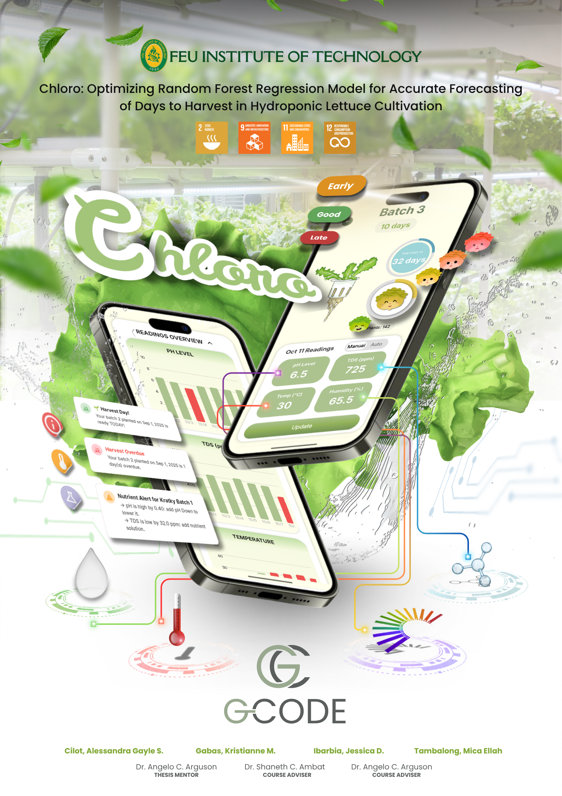
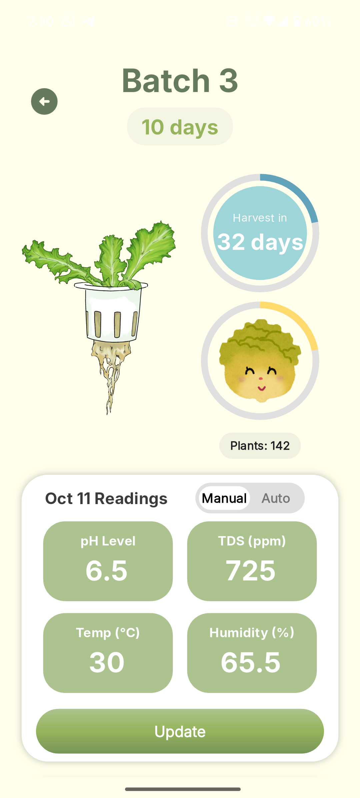
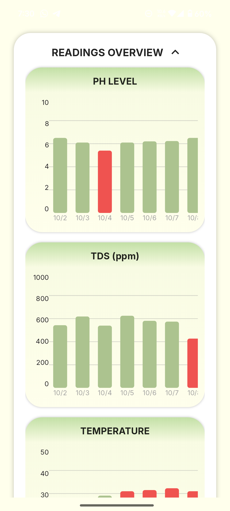
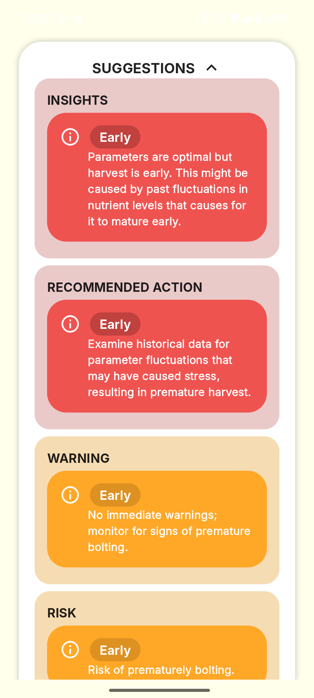

# Chloro

**Optimizing Random Forest Regression Model for Accurate Forecasting of Days to Harvest in Hydroponic Lettuce Cultivation**

Chloro is an Android decision-support application for beginner and small-scale hydroponic growers. It monitors the conditions that most strongly affect green leaf lettuce growth and uses a Random Forest regression model to forecast the number of days remaining until the optimal harvest date.

The system focuses on four growing conditions:

- pH level
- Total Dissolved Solids (TDS)
- Air temperature
- Relative humidity

Chloro was developed as an undergraduate thesis project for the Bachelor of Science in Computer Science with Specialization in Software Engineering program at FEU Institute of Technology.

## Research Poster

<p align="center">
  
</p>

## Application Preview

<p align="center">
  
  
  
  
</p>

## Key Features

- User registration, authentication, and profile management
- Garden and cultivation-batch management
- Support for Nutrient Film Technique (NFT) and Kratky hydroponic systems
- Manual and sensor-based recording of pH, TDS, temperature, and humidity
- Forecasting of the remaining days until harvest
- Crop-health and growth-stage monitoring
- Corrective recommendations for pH and TDS conditions
- Scheduled alerts and local notifications
- Cultivation calendar and batch history
- Built-in hydroponic growing guides
- Offline and network-status feedback

## How the System Works

```text
Grower / Sensors
       |
       v
Flutter Android Application
       |
       +---- Supabase Authentication and Database
       |
       +---- FastAPI REST Service
                    |
                    v
          Random Forest Regressor
                    |
                    v
       Harvest Forecast and Recommendations
```

The Flutter application provides the user interface and accepts manual or sensor-derived readings. Supabase manages authentication and application data. A FastAPI service runs the trained Random Forest model and returns harvest forecasts to the mobile application.

> [!NOTE]
> This repository contains the Flutter mobile client. The trained model, FastAPI service, Supabase schema, and Row Level Security policies are external dependencies and are not included here.

## Research Highlights

The study combined open-source and locally collected records into a dataset containing **617 plants** and **26,836 instances**. Feature engineering produced 84 candidate features, which were reduced to 23 using Random Forest-based Recursive Feature Elimination with Cross-Validation (RF-RFECV). Temperature, humidity, pH, and TDS remained key inputs.

The thesis reported the following model results:

| Model stage | MAE | RMSE | R² |
| --- | ---: | ---: | ---: |
| Selected Random Forest benchmark | 0.049852 | 0.223275 | 0.992887 |
| Fine-tuned Random Forest pipeline | 0.077653 | 0.226220 | 0.992699 |

The model was evaluated against LSTM-RF, XGBoost, Gradient Boosting, Support Vector Regression, and LSTM. The complete system was evaluated using ISO 25010 software-quality characteristics and the Technology Acceptance Model.

## Exploratory Data Analysis

The project includes a separate Jupyter notebook, `EDA.ipynb`, used to investigate how the four monitored conditions relate to the harvest day and to train a baseline Random Forest regressor.

The exploratory workflow covers:

- Dataset inspection, descriptive statistics, missing values, and duplicate checks
- A correlation heatmap for temperature, humidity, TDS, pH, and harvest day
- Partial Dependence Plots for examining non-linear feature behavior
- Random Forest feature-importance analysis
- An 80/20 train-test split for baseline model development

The correlation analysis found weak linear relationships between the individual growing conditions and harvest day. Partial-dependence analysis revealed more complex non-linear behavior, supporting the use of a non-linear regression model. In the baseline Random Forest analysis, TDS and pH had the highest feature-importance scores, while temperature and humidity contributed less individually.

The EDA notebook expects the source dataset at `data/target_final_dataset.csv`. The notebook demonstrates the exploratory and baseline-modeling stage; the thesis's complete optimized pipeline additionally uses feature engineering, RF-RFECV feature selection, RandomizedSearchCV hyperparameter tuning, comparative model evaluation, and FastAPI deployment.

## Technology Stack

| Layer | Technology |
| --- | --- |
| Mobile application | Flutter and Dart |
| Authentication and database | Supabase |
| Prediction API | Python and FastAPI |
| Machine-learning model | Scikit-learn Random Forest Regressor |
| Design and prototyping | Figma |
| Supported mobile platform | Android |

## Getting Started

### Prerequisites

- Flutter SDK 3.47 or newer
- Dart SDK included with Flutter
- Java 21
- Android Studio with Android SDK Platform 36
- An Android emulator or physical Android device
- Access to compatible Supabase and prediction-service deployments for live features

Check the development environment:

```bash
flutter doctor -v
```

### Installation

1. Clone the repository:

   ```bash
   git clone https://github.com/YOUR_USERNAME/chloro.git
   cd chloro
   ```

2. Install Flutter dependencies:

   ```bash
   flutter pub get
   ```

3. List available devices:

   ```bash
   flutter devices
   ```

4. Run the application:

   ```bash
   flutter run -d DEVICE_ID
   ```

For the local emulator used during development, the command may look like:

```bash
flutter run -d emulator-5554
```

## Backend Configuration

Before using the application with a new backend deployment, update:

- The Supabase project URL and anonymous client key in `lib/main.dart`
- The prediction-service endpoints in `lib/services/auto_batch_services.dart` and `lib/pages/batch/batch_info.dart`
- The authentication callback scheme in the Android and iOS platform configuration when required

Do not commit service-role keys, database passwords, signing keys, or other privileged credentials. A Supabase anonymous client key is intended for client applications, but the database must still be protected by appropriate Row Level Security policies.

## Project Structure

```text
lib/
├── helpers/       Reusable UI and status helpers
├── pages/
│   ├── auth/      Login and registration
│   ├── batch/     Batch monitoring, readings, and forecasts
│   └── home/      Dashboard, calendar, notifications, and account
├── services/      Networking, notifications, and background processing
└── main.dart      Application initialization and routing
```

## Study Scope and Limitations

- The forecasting model is limited to green leaf lettuce.
- The supported cultivation methods are NFT and Kratky systems.
- Forecasting uses pH, TDS, air temperature, and relative humidity.
- Forecast accuracy generally improves as more crop-cycle data becomes available.
- Live application functionality depends on the external API and Supabase services.
- Future work may include light intensity, airflow, nitrogen, phosphorus, potassium, other crops, and alternative regression models.

## Researchers

- Alessandra Gayle S. Cilot
- Kristianne M. Gabas
- Jessica D. Ibarbia
- Mica Ellah Tambalong

**Thesis adviser:** Dr. Angelo C. Arguson  
**Institution:** FEU Institute of Technology  
**Year:** 2025

## Academic Use

This repository contains an academic research prototype. Any deployment used for operational crop decisions should be independently validated for its specific sensors, environment, crop variety, and cultivation method.
